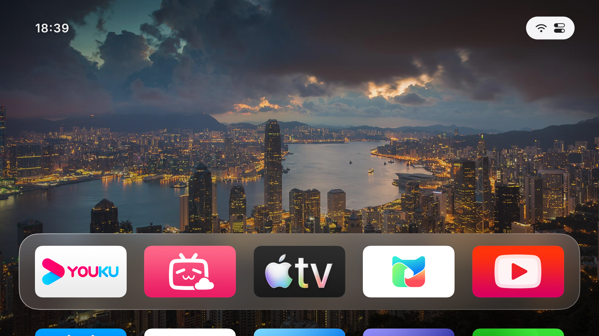
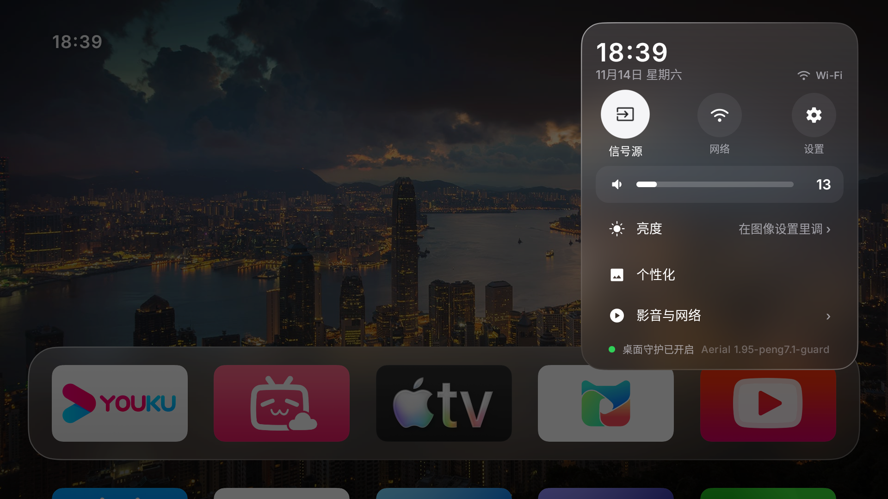
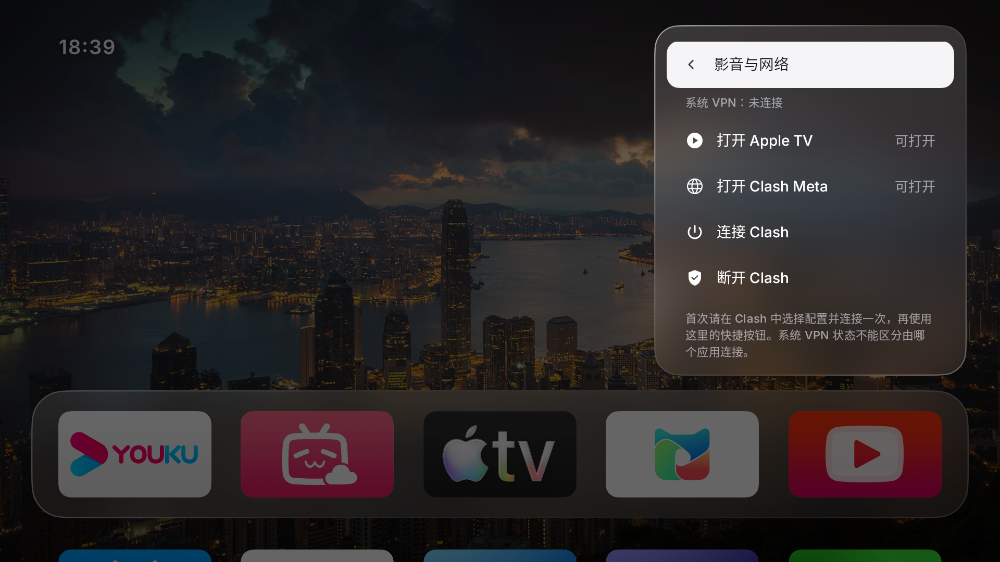
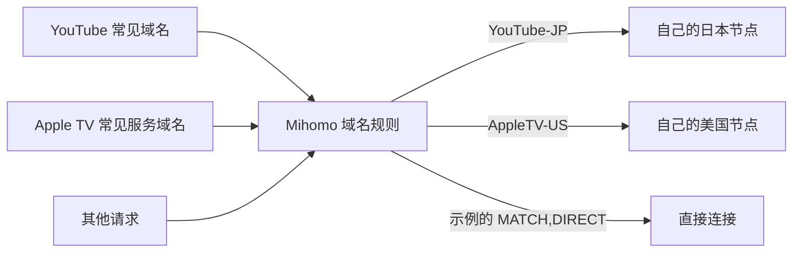

# Peng7 TV Kit

**把雷鸟鹏 7 Pro 的桌面、Apple TV、YouTube 和电视端代理整理成一套可复现的配置。**

基于 [Aerial](https://github.com/pengchujin/aerial-tv) 的桌面定制补丁，配套设备检查脚本、安装与恢复指南，以及不含真实节点的 Mihomo 分流示例。起点是一台雷鸟鹏 7 Pro 的实际配置过程，目标是让其他使用者知道该准备什么、怎样复现、哪些地方仍需自己验证。

[真机截图](#真机截图) · [快速开始](#快速开始) · [实测设备与兼容性](#实测设备与兼容性) · [分流配置](#分流配置) · [排查问题](#排查问题) · [常见问题](#常见问题)

> **当前交付形态：源码补丁 + 配置模板 + 操作指南。** 本仓库尚未提供可直接下载的定制 APK。应用补丁后需自行构建和签名；只想使用 Aerial 桌面时，可以从上游项目开始。

## 真机截图

以下三张图片均于 **2026-11-14** 从雷鸟鹏 7 Pro 65 英寸、3GB / 64GB 的实际电视直接截取，保留原始 **1920 × 1080** PNG，未经拼接或界面重绘。点击图片可查看原图。

### 桌面与第一排应用

[](docs/images/tv-home.png)

第一排依次为 CIBN 酷喵、云视听小电视、Apple TV、BesTV 粤视厅和 YouTube，展示原有影音应用与新增入口的实际排列。

### 控制中心与影音快捷操作

| 控制中心 | 影音与网络 |
| --- | --- |
| [](docs/images/tv-control-center.png) | [](docs/images/tv-media-tools.png) |
| 可见定制版本 `1.95-peng7.1-guard`，桌面守护已开启。 | Apple TV 与 Clash Meta 均被识别为“可打开”，并提供连接／断开按钮。 |

截图保留拍摄时的真实状态：**系统 VPN 未连接**。这些图片展示桌面与控制入口；历史播放结果及尚未验证的项目见下方兼容性记录。

## 配置完成后能做什么

在同一个电视桌面打开原有应用、Apple TV 和 YouTube，在控制中心集中打开 Apple TV、Clash Meta，并向 Clash 发送连接或断开命令。影音应用各自负责登录和播放，电视端代理客户端负责网络连接与分流。

第一排可以按自己的习惯排序。例如下面的布局，把 Apple TV 放在第 3 位、YouTube 放在第 5 位；原来的夸克和购物应用仍可保留在后面的应用列表中。

```text
第一排布局示意（非界面截图）
┌────────────┬────────────┬────────────┬────────────┬────────────┐
│ 原有应用 1 │ 原有应用 2 │  Apple TV  │ 原有应用 3 │  YouTube   │
└────────────┴────────────┴────────────┴────────────┴────────────┘

控制中心 → 影音与网络
  ├─ 打开 Apple TV
  ├─ 打开 Clash Meta
  ├─ 连接 Clash
  ├─ 断开 Clash
  └─ 系统 VPN 状态
```

### 哪些来自上游，哪些由本项目补充

| 内容 | 来源与作用 |
| --- | --- |
| Aerial 桌面、应用展示、排序、手机设置页与桌面守护 | 沿用 Aerial；基础桌面功能归上游项目 |
| 「影音与网络」页面 | 本项目补丁新增 Apple TV、Clash Meta 的启动入口及明确的连接／断开操作 |
| 应用可用状态 | 返回页面时重新检查应用入口；缺少客户端时给出提示 |
| 系统 VPN 状态 | 显示 Android 的通用 VPN 状态；具体由哪个客户端、哪个节点连接，需在客户端核对 |
| 定制版更新处理 | 显示定制版本号并关闭上游自动更新，后续使用自己的签名包手动升级 |
| 设备检查与配置资料 | 本仓库提供只读检查脚本、安装与恢复步骤、实测记录及分流示例 |

YouTube 使用普通应用入口和桌面排序，当前补丁没有 YouTube 专用控制按钮。Clash 快捷按钮依赖已安装客户端提供相应控制入口；首次配置和 VPN 授权仍在 Clash 中完成。按钮代码及相关单元测试已包含在补丁中，完整的真机连接／断开循环仍待补充验证。

## 实测设备与兼容性

以下为 **2026-11-12 的单台设备记录**，版本号用于复现当时环境，不代表最新版本推荐。

| 设备项 | 实测值 |
| --- | --- |
| 型号 | 雷鸟鹏 7 Pro，65 英寸 |
| 内存／存储 | 3GB / 64GB |
| 系统设备名 | `tcl_mt5879_cn` |
| 系统版本 | Android 11 / API 30 |
| 应用架构（ABI） | `armeabi-v7a`，即 32 位 ARM 应用环境 |

**下载应用时以实际 ABI 为准。** 同系列名称、相同尺寸或处理器宣传信息，都不能代替设备读取结果。

| 组件 | 测试版本 | 实际结果 |
| --- | --- | --- |
| Aerial 定制版 | `1.95-peng7.1-guard` | 桌面与新增页面显示正常；启用守护后 HOME 返回已验证，原有助手服务保留 |
| Clash Meta | `2.11.37.Meta` | VPN 连接与实际联网通过；核对过 YouTube 视频域名匹配日本组、Apple TV 服务域名匹配美国组 |
| Apple TV | `17.0.2` | 实际正片播放，使用者确认画面、声音正常 |
| YouTube Fire TV | `25.50.r1.v197.0` | 匿名试播要求登录验证；使用者自行完成后实际播放，画面、声音正常 |
| YouTube Android TV | `8.02.300` | 提示设备不支持，未采用 |
| SmartTube | stable `32.71` / beta `32.74` | 列表可加载；试播出现 403 与 WebView renderer crash，未完成可用验证 |

YouTube Fire TV 是 Google 面向 Fire TV 的官方发行版本；在本机可用不等于 Google 官方支持这台雷鸟。完整包名、应用来源、当时文件的摘要与签名记录见 [兼容性文档](docs/COMPATIBILITY.md)。

**尚未验证：** 4K、HDR、杜比格式、长时间与晚高峰稳定性、重启及待机后的桌面与 VPN 恢复、HDMI、原厂会员的完整回归。其他机型与固件也需单独验证。目前没有真机帧率、启动耗时或内存优化的测量结论。

## 快速开始

按“先检查设备，再准备桌面，最后逐个验证播放”的顺序操作。下面的电脑命令以 **Windows + PowerShell 7** 为例。

### 1. 准备工具和自己的服务

| 用途 | 需要准备 |
| --- | --- |
| 获取与准备源码 | Git、PowerShell 7 |
| 读取电视信息 | Android SDK Platform Tools 中的 `adb`；电视允许网络调试并授权自己的电脑 |
| 构建定制桌面 | JDK 17 或经验证兼容的版本、Android SDK Platform 36、Build Tools 36；首次构建需下载 Gradle / Maven 依赖 |
| 检查与打包公开文件 | Python 3 |
| 使用影音服务 | 对应客户端、自己的账号与所需订阅；使用代理时需自备节点或配置 |

将 `git`、`pwsh`、`adb` 等工具加入终端 PATH，或在脚本参数中指定实际程序路径。电视与电脑连接同一局域网；ADB 的开启入口按自己的固件确认。

### 2. 获取本仓库并记录电视原设置

```powershell
git clone https://github.com/alex19950221/peng7-tv-kit.git
Set-Location peng7-tv-kit

# 在本机输入电视网络设置中显示的地址
$tvAddress = Read-Host '电视的局域网 IPv4 地址'
pwsh -File scripts/inspect-tv.ps1 -Address $tvAddress -AdbPath adb
```

首次连接时，在电视上确认允许这台电脑调试。脚本读取型号、系统版本、ABI、相关应用是否存在，以及当前无障碍服务和开机组件设置；**不安装应用、不修改电视设置**。ADB 连接及本地报告写入是它的副作用。

报告保存到被忽略的 `local/tv-inspection-*.json`。其中有设备地址和原设置，请留作自己恢复时使用。若只阅读项目或准备源码，可以跳过连接电视这一步。

### 3. 准备 Aerial 定制源码

在仓库根目录运行：

```powershell
pwsh -File scripts/prepare-aerial.ps1
```

脚本会下载锁定的上游提交、核对补丁 SHA256、检查补丁能否应用，再生成 `.work/aerial-tv/`。默认目标目录非空时会停止，避免覆盖已有工作；重复准备时可用 `-Destination` 指定另一个空目录。

| 版本项 | 当前固定值 |
| --- | --- |
| 上游项目 | `pengchujin/aerial-tv` |
| 上游版本 | Aerial `1.95` |
| 上游提交 | `a0f4b59c5a76a0a549410154d7009399d45b5a22` |
| 定制版本／版本号 | `1.95-peng7.1` / `136` |
| 锁定文件 | [`upstream.lock.json`](upstream.lock.json) |

采用固定基线，方便复现和检查补丁；升级上游需要重新验证。准备脚本只操作电脑上的源码。

### 4. 配置自己的签名并构建

先按 [构建说明](docs/BUILD.md) 配置 SDK 路径，生成自己的签名密钥，并填写生成源码目录下的 `local/signing.properties`。**缺少签名配置时上游会回落到 debug 签名，发布前需检查产物使用的实际证书。**

完成上述配置后，在仓库根目录进入源码并构建：

```powershell
Set-Location .work/aerial-tv
.\gradlew.bat :app:assembleStandardRelease :app:assembleGuardRelease
```

| 构建变体 | 特点 | 输出目录 |
| --- | --- | --- |
| Standard | 向系统声明为 HOME 桌面候选 | `app/build/outputs/apk/standard/release/` |
| Guard | 不声明 HOME；本案例采用此变体并启用桌面守护 | `app/build/outputs/apk/guard/release/` |

本机固件拒绝直接 ADB 安装，使用 TCL 多屏互动推送 Guard 包后在电视确认安装成功。请按 [安装指南](docs/SETUP.md) 和锁定源码中的机型文档选择安装方式；上游在线安装命令可能取得官方签名包，不能直接作为本定制版的更新命令。

### 5. 分别安装、配置并验证影音应用

1. **Clash Meta：** 从 [项目 Releases](https://github.com/MetaCubeX/ClashMetaForAndroid/releases) 选择符合系统与 ABI 的客户端，导入自己的配置，完成首次 VPN 授权并连接。可参考下方的 [分流配置](#分流配置)。
2. **Apple TV：** 按 [应用来源与版本记录](docs/COMPATIBILITY.md#应用来源与原签名) 选择客户端，由使用者自行登录并确认所需订阅，实际播放一段正片。
3. **YouTube：** 先查兼容性记录；本机普通 Android TV 版提示不支持，Fire TV 版在完成登录验证后可播放。由使用者自行扫码或按屏幕提示登录，再检查画面与声音。

每个应用单独试播成功后，再整理桌面入口。账号密码、验证码和登录二维码不需要提供给项目维护者。

### 6. 整理布局、配置 HOME 并验证恢复

使用 Aerial 自带排序或电视显示的手机设置页调整应用顺序。手机设置页带控制令牌，应仅在自己的局域网使用，分享时不要带上真实地址或二维码。

是否启用无障碍桌面守护由设备所有者决定。启用时保留已有小 T 助手等服务；开机应用设置与 HOME 守护须分别记录，恢复时也分别处理，详见 [桌面守护与恢复](docs/SETUP.md#5-桌面守护与恢复)。

用自己的设备逐项验收：

- [ ] 遥控器能选中并打开应用，HOME 键按预期返回。
- [ ] Apple TV 正片和 YouTube 视频的画面、声音正常。
- [ ] 在代理客户端确认目标域名、命中规则和实际出口节点。
- [ ] 原桌面、原有会员应用与 HDMI 功能按自己的使用需求验证通过。
- [ ] 重启、待机唤醒后检查桌面与 VPN 是否恢复。
- [ ] 知道如何关闭新增守护、回到原桌面，再考虑卸载或更换定制版。

这里是供复现者使用的验收清单，不表示本项目已完成所有项目的真机验证。

## 分流配置

示例文件：[`examples/mihomo-tv.example.yaml`](examples/mihomo-tv.example.yaml)。Mihomo 是代理内核，本示例可用于理解与合并其分流规则；Android 上的 VPN / TUN 和 DNS 仍由客户端配置。



| 分组 | 示例覆盖内容 | 需要自己提供 |
| --- | --- | --- |
| `YouTube-JP` | YouTube 常见页面、图片和视频域名，例如 `youtube.com`、`googlevideo.com`、`ytimg.com` | 可用的日本节点 |
| `AppleTV-US` | Apple TV 常见服务域名，例如 `tv.apple.com` 与列出的播放服务域名 | 可用的美国节点 |

在仓库根目录复制一份本地配置再编辑：

```powershell
New-Item -ItemType Directory -Force local | Out-Null
Copy-Item examples/mihomo-tv.example.yaml local/mihomo-tv.yaml
```

将示例中的服务器、密码和证书对应域名替换为自己的服务信息，或把分组与规则合并到自己的订阅覆写中。`jp.example.com`、`us.example.com` 和 `CHANGE_ME_*` 都是占位值，原样导入无法联网。复用电脑配置时，需重新检查电视客户端的 DNS、VPN 和覆写设置。

**规则按域名匹配，并非整个应用固定走一个节点。** 登录、广告和共用服务可能命中其他规则；示例也没有收录平台全部域名。合并时将专用规则放在较宽的通用规则之前，并按自己的需求处理最后的默认出口；本示例的 `MATCH,DIRECT` 会让未命中请求直连。

验证时查看“目标域名 → 命中规则 → 实际节点”，再实际播放。分组名称只表达配置意图，不能证明节点出口所在地或平台识别地区。示例使用 HY2（Hysteria 2 协议）；能否稳定看视频仍要看节点与实际网络表现，不因使用 HY2 就保证更快。完整说明见 [分流文档](docs/ROUTING.md)。

## 排查问题

| 现象 | 先检查什么 |
| --- | --- |
| ADB 连接失败或显示未授权 | 电视与电脑是否同网、地址与端口是否正确、网络调试是否开启、电视是否已允许这台电脑 |
| 准备源码时提示目标目录非空 | 查看目录是否有需保留的工作；用 `-Destination` 指定其他空目录，不要直接覆盖 |
| 定制 Aerial 不能覆盖已有版本 | 核对包名、版本号和签名；不同签名不能直接覆盖，先处理已有布局与数据，再决定迁移方式 |
| 电视拒绝 ADB 安装 | 查对应固件和机型文档；本机采用多屏互动推送并在电视确认，不能假定所有固件安装方式相同 |
| 「影音与网络」提示应用不可用 | 客户端是否已安装、启用，并提供本补丁识别的启动或控制入口；先尝试直接打开客户端 |
| VPN 显示已连接，但视频不播放 | 在 Clash 中核对当前配置、实际规则与节点，再检查服务登录和具体播放错误；VPN 图标不能代替这些检查 |
| YouTube 提示不支持或要求登录验证 | 对照已记录的客户端版本与设备环境；需要登录时由使用者自行完成，不能把登录验证直接判为代理故障 |
| HOME 键没有返回 Aerial | 检查所用变体与桌面守护设置；记录当前配置并保留已有无障碍服务，不要整串覆盖服务值 |

上述步骤与恢复细节见 [安装指南](docs/SETUP.md)。无法复现时，可在 [Issues](https://github.com/alex19950221/peng7-tv-kit/issues) 提供机型、固件、ABI、应用版本、复现步骤和已脱敏的错误信息。

## 常见问题

### 这会把电视刷成另一个操作系统，或变成 Apple TV 盒子吗？

本项目运行在电视原有 Android 系统上，调整桌面入口和应用配置。它不提供系统 ROM、Bootloader 解锁或 Apple tvOS；安装 Apple TV 应用也不等于获得 Apple TV 盒子的系统功能。

### 换桌面后，原厂会员和现有订阅怎么用？

从新桌面打开原有客户端，继续由对应账号、应用和服务判断权益；桌面本身不提供或合并会员。本案例保留了原有应用，但原厂会员尚未完成完整回归，复现后应自行登录和试播核对。Apple TV 与 YouTube 也各自使用相应账号及所需订阅。

### 能直接装到其他雷鸟、TCL 或 Android 电视吗？

可先读取设备信息，参考本项目的方法验证。当前依据只覆盖上表中的一台设备与当时固件；即使同名机型，Android 版本、ABI、安装限制及守护行为也可能不同。欢迎提交带验证范围的机型记录。

### 为什么提供补丁，而不是把整个 Aerial 源码复制一遍？

固定上游提交加独立补丁，便于查看本项目具体改了哪些文件，也便于在升级上游时重新检查差异。基础源码由准备脚本取得，定制内容由本仓库记录；使用者可以保留自己的签名和后续修改。

### 后续怎么更新、怎么恢复？

定制版使用自己的签名包手动更新，不自动跟随 Aerial 官方更新。升级时保留相同签名并正确增加版本号；恢复时先撤销自己新增的守护项、恢复已记录的开机组件，确认原桌面与 HOME 可用后再决定是否卸载。操作细节分别见 [构建说明](docs/BUILD.md) 和 [恢复说明](docs/SETUP.md#5-桌面守护与恢复)。

## 仓库结构与文档入口

```text
peng7-tv-kit/
├─ README.md                      项目介绍与复现入口
├─ upstream.lock.json             上游版本、提交、补丁摘要及文件清单
├─ patches/aerial-peng7.patch      定制功能与相关单元测试
├─ examples/mihomo-tv.example.yaml 分流示例，所有节点均为占位值
├─ scripts/
│  ├─ inspect-tv.ps1              读取电视信息并在本地保存报告
│  ├─ prepare-aerial.ps1          获取固定上游并应用补丁
│  ├─ check-public.py             检查公开文件清单、补丁摘要与敏感内容
│  └─ package-public.py           按公开清单生成源码 ZIP
├─ docs/
│  ├─ images/                     真机原始截图与逐图审核摘要
│  ├─ BUILD.md                    环境、签名、构建与验证
│  ├─ SETUP.md                    安装、应用布局、守护与恢复
│  ├─ ROUTING.md                  分流规则、合并方法与验证
│  └─ COMPATIBILITY.md            单台设备的成功与失败记录
└─ public-files.txt               允许公开打包的文件清单
```

`.work/` 保存生成的源码，`local/` 保存自己的配置或设备报告，`dist/` 保存打包产物；这些本地目录均被忽略。

## 开发、验证与分享

本补丁包含应用启动与 Clash 命令、影音页面、定制更新处理的单元测试。历史开发验证记录包含选取的 32 项单测、Standard / Guard Release 构建和上表中的真机操作；运行命令见 [构建文档](docs/BUILD.md)。公开整理另检查了补丁可应用、文件一致性、PowerShell 语法和 Mihomo 示例配置，这些检查不等同于新增真机测试。

修改后，在仓库根目录运行公开内容检查与打包：

```powershell
python scripts/check-public.py
python scripts/package-public.py
```

打包器只收录 [`public-files.txt`](public-files.txt) 中的文件，生成 `dist/peng7-tv-kit-source.zip` 与校验文件。修改补丁时需同步更新锁定文件中的摘要并重新验证；新增公开文件时需更新清单。真机 PNG 另按 [`docs/images/reviewed.json`](docs/images/reviewed.json) 核对逐图审核记录与 SHA256，图片内容仍需人工检查。详见 [贡献说明](CONTRIBUTING.md)。

仓库不分发第三方 APK、会员账号、代理订阅、真实服务器、签名私钥、设备报告或登录二维码。自动扫描不能代替人工审阅；提交配置、日志与截图前，检查其中是否仍有订阅、令牌或账号信息。安全问题的处理见 [SECURITY.md](SECURITY.md)。

## 致谢与许可

基础桌面来自 [pengchujin/aerial-tv](https://github.com/pengchujin/aerial-tv)，本项目保留原作者声明。补丁和脚本遵循 [MIT 许可](LICENSE)；外部应用、字体与其他资源的许可见 [第三方说明](THIRD_PARTY_NOTICES.md)。

本项目是社区定制与配置记录，与 Aerial、TCL、雷鸟、Apple、Google 及 MetaCubeX 无官方隶属关系。
